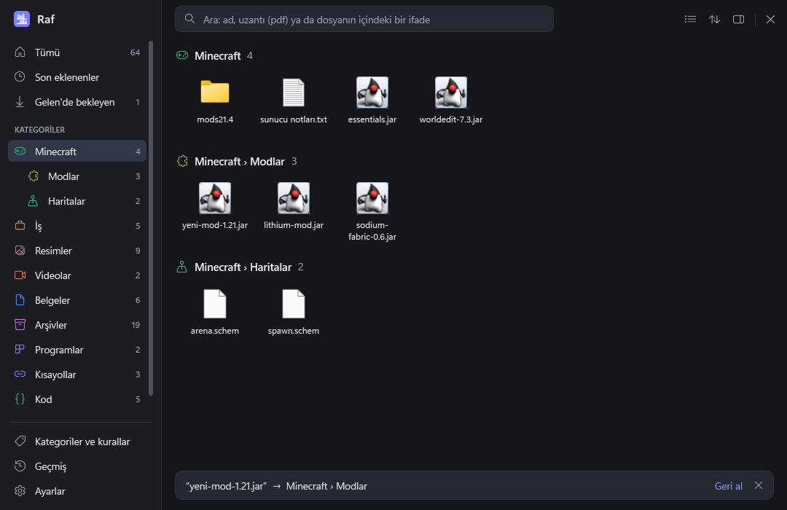
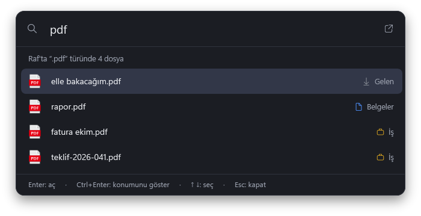
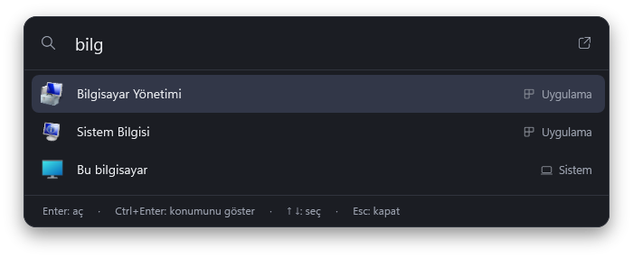
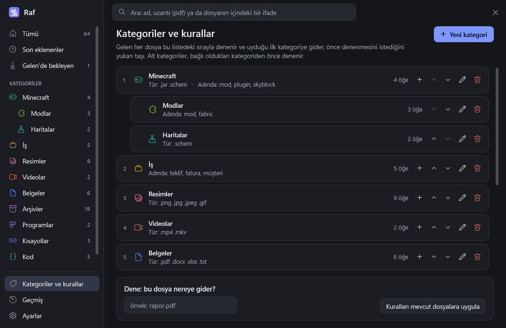

# Raf

Windows için masaüstü düzenleyici. Bir şey kaydederken ya da indirirken hep aynı klasörü ("Gelen")
seçersin; Raf dosyayı senin kurallarına göre doğru kategoriye taşır ve hepsini tek pencerede,
aranabilir biçimde gösterir. Alt+Space ile açılan arama çubuğu dosyalarını da kurulu uygulamalarını
da bulur.

*Raf is a Turkish-language desktop organizer for Windows (WPF, .NET 9): save everything into one
inbox folder, let your rules sort it into categories, and find files and apps with an Alt+Space
launcher.*



## Öne çıkanlar

- **Tek kaydetme klasörü:** "Gelen"e düşen her dosya kurallarına göre kategorisine taşınır; kurala
  uymayan türüne göre yerleşir. İstersen İndirilenler gibi klasörler de izlenir.
- **Senin kuralların:** dosya türü, adında geçen kelime, indirildiği site. Kategoriler ve bir seviye
  alt kategori ("Minecraft › Modlar"), her birinin simgesi ve rengiyle.
- **Hızlı arama (Alt+Space):** Raf'taki dosyalar, kurulu uygulamalar ve sistem yerleri tek çubukta.
  Yalnızca uzantı yazınca (`pdf`) o türdeki dosyalar listelenir.
- **Var olanları içeri alma:** masaüstünde ve diğer klasörlerde birikmiş dosyalar önizlemeyle
  kategorilere yerleştirilir; klasörler yerinde kalıp bağlantı olarak eklenir.
- **Hiçbir şey silinmez:** her taşıma geçmişe yazılır ve tek tıkla eski yerine geri alınır.
- **Gerçek klasörler:** her kategori diskte sıradan bir klasördür; Raf'ı kaldırsan da düzen yerinde kalır.
- Küçük resimler, önizleme bölmesi, dosya içeriğinde arama, dosya işlemleri, masaüstü arama kutucuğu,
  açık ve koyu tema.

| Uzantıya göre arama | Uygulama ve sistem yerleri |
| --- | --- |
|  |  |



## Kurulum

Windows 10 ya da 11 (64 bit) gerekir. Kurulum yönetici izni istemez; her şey o kullanıcının kendi
alanına kurulur.

### Kaynaktan

[.NET 9 SDK](https://dotnet.microsoft.com/download/dotnet/9.0) gerekir. Aşağıdaki komut derler ve bu
kullanıcı için kurar; kodda değişiklik yaptıktan sonra güncellemek için de aynı komut çalıştırılır:

```bash
powershell -ExecutionPolicy Bypass -File kur.ps1
```

Kurulum program dosyalarını `%LOCALAPPDATA%\Programs\Raf` altına kopyalar, Başlat menüsüne "Raf"
kısayolu koyar, Windows açılışında başlatmayı ayarlar ve Ayarlar > Uygulamalar > Yüklü uygulamalar
listesine "Raf" kaydını ekler. Kaldırmak için o listeden "Kaldır" ya da `kaldir.ps1`; ikisi de
dosyalara ve ayarlara dokunmaz.

Kurmadan denemek için: `dotnet publish src/Raf.App -c Release -o dist`, ardından `dist\Raf.exe`.

### Başka bilgisayar için kurulum programı

.NET 9 SDK'nın yanında [Inno Setup 6](https://jrsoftware.org/isinfo.php) gerekir:

```bash
powershell -ExecutionPolicy Bypass -File paketle.ps1
```

Çıktı `paket` klasörüne yazılır:

- `Raf-Kurulum-<sürüm>.exe`: kurulum programı. .NET'i içinde taşır; hedef bilgisayarda başka bir şey
  gerekmez. `kur.ps1` ile aynı yere kurar, eski sürümün üstüne kurulabilir ve Ayarlar > Uygulamalar
  listesinden kaldırılır.
- `Raf-<sürüm>.zip`: kurulum programı ve adım adım anlatan `OKUBENİ.txt`.

Kurulum programı imzalı değildir; indirildiği bilgisayarda Windows SmartScreen ilk açılışta uyarı
gösterir ("Ek bilgi" > "Yine de çalıştır"). Paketleme baştan derler ve hata ayıklama bilgisi eklemez;
dosyalardan birinde derleyen bilgisayarın kullanıcı klasörünün yolu geçerse paket hazırlanmaz.

Sürüm numarası `src/Raf.App/Raf.App.csproj` içindeki `<Version>` değerinden okunur.

## İlk kullanım

Raf yalnızca kendi klasörüne giren dosyaları gösterir; yeni kurulduğunda boştur. Karşılama ekranı
dört adım önerir:

1. **Sabitle:** "Gelen" klasörü Hızlı Erişim'e sabitlenir ve her "Farklı kaydet" penceresinin solunda görünür.
2. **İzlemeye al:** İndirilenler'e yeni düşen dosyalar da kendiliğinden yerleştirilir.
3. **Kategorilere git:** kendi kategorilerini ve kurallarını oluştur.
4. **İçeri al:** masaüstünde ve diğer klasörlerde birikmiş olanları getir.

Sonrasında Alt+Space arama çubuğunu, saatin yanındaki Raf simgesi tam pencereyi açar.

## Nasıl çalışır

- **Gelen klasörü:** `%USERPROFILE%\Raf\Gelen`. Buraya düşen her şey, yazılması bitince taşınır.
- **Kategoriler:** `%USERPROFILE%\Raf\<Kategori>` altında gerçek klasörlerdir. Her kategorinin kuralı
  olabilir: dosya türü, adında geçen kelime, indirildiği site. Kategoriler sırayla denenir, ilk uyan kazanır.
  Her kategorinin bir simgesi ve rengi vardır; ikisi de kategori düzenleme penceresinden seçilir.
- **Alt kategoriler:** bir kategorinin altına bir seviye alt kategori açılabilir ("Minecraft › Modlar").
  Klasörü üst kategorinin klasörünün içindedir ve kuralları üst kategoriden önce denenir.
- **Kurala uymayan:** türüne göre hazır kategorilere (Resimler, Belgeler, Arşivler…) gider, o da
  olmazsa "Diğer"e düşer.
- **Ek izlenen klasörler:** örneğin İndirilenler. Buralarda yalnızca izleme başladıktan sonra gelen
  dosyalara dokunulur.
- **Bağlantılar:** yeri değişmemesi gereken öğeler (proje klasörleri gibi) taşınmadan bir kategoride gösterilir.
- **Var olanları içeri alma:** karşılama ekranındaki ya da Ayarlar'daki "İçeri al…" ile seçilen klasörlerin
  (Masaüstü, İndirilenler, Belgeler…) en üst düzeyindeki dosyalar kurallara göre kategorilere taşınır,
  klasörler yerinde bırakılıp "Klasörler" kategorisine bağlantı olarak eklenir. Önce neyin nereye
  gideceği gösterilir; iş bitince çıkan bildirimden hepsi birden, sonra da Geçmiş'ten tek tek geri alınabilir.
- **Geri al:** her taşıma kaydedilir. Geri alınan öğe eski yerine döner ve bir daha kendiliğinden taşınmaz.
- **Arama:** ada göre arar (Türkçe harf ve büyük/küçük farkını yok sayar). Yalnızca uzantı yazılırsa
  (`pdf`, `.pdf`, `*.pdf`) o türdeki dosyalar ayrı ve önce listelenir; `fatura .pdf` gibi kelime ve
  uzantı birlikte de yazılabilir.
- **İçerik araması:** üç harf ve üzeri sorgularda dosyaların içine de bakılır: düz metin dosyaları ve
  docx/xlsx/pptx. PDF'lerin içi aranmaz; klasör öğelerinin içine girilmez.
- **Hızlı arama çubuğu:** kısayol tuşu (varsayılan Alt+Space) ekranın ortasında küçük bir arama
  çubuğu açar: yaz, ↑ ↓ ile seç, Enter'la aç, Ctrl+Enter'la konumunu göster, Esc ile kapat. Çubuk boşken
  Enter ya da sağdaki düğme tam pencereyi açar. Tam pencere tepsi simgesinden de açılır.
  Çubuk Raf'taki öğelerin yanında kurulu uygulamaları (Başlat menüsündekiler), sistem yerlerini
  (Bu bilgisayar, Geri Dönüşüm Kutusu…) ve masaüstündekileri de bulur; bunlar yalnızca listelenir,
  Raf'a alınmaz ya da taşınmaz. Ayarlar'dan kapatılabilir.
- **Kısayol tuşu:** tam ekran bir oyun ya da video öndeyken kendiliğinden devre dışı kalır; başka
  bir pencereye geçince geri gelir.
- **Arama kutucuğu:** masaüstünde duran küçük "Uygulama ara" kutucuğu; tıklanınca olduğu yerde,
  ortası sabit kalarak iki yana genişler ve içine yazılır. Sürüklenerek taşınır, yeri hatırlanır.
  Sağ tık menüsünden her zaman üstte tutulabilir ya da gizlenebilir; Ayarlar'dan yeniden açılır.
- **Varsayılan sekme:** tam pencerede kenar çubuğundaki bir sekmeye sağ tıklayıp "Varsayılan yap"
  denince Raf o sekmeyle açılır. Aramaya "raf" yazıp Enter'a basmak da tam pencereyi o sekmede açar.
- **Dosya işlemleri:** yeniden adlandır (F2), Geri Dönüşüm Kutusu'na gönder (Del), kes/kopyala/yapıştır
  (Ctrl+X/C/V, Dosya Gezgini ile iki yönlü), yeni klasör, Windows'un Özellikler penceresi (Alt+Enter).
  Yeniden adlandırma da geçmişe yazılır ve geri alınabilir.
- **Görünüm:** kutucuklar ya da ayrıntı listesi; ada, eklenme tarihine, boyuta ya da türe göre sıralama;
  seçili öğeyi büyük gösteren önizleme bölmesi (metin dosyalarının içeriğinin başıyla birlikte).
- **Küçük resimler:** resim ve videolarda Dosya Gezgini'nin gösterdiği küçük resmin aynısı kullanılır
  (Windows'un küçük resim üretebildiği her biçim); diğer dosyalarda türün simgesi görünür.

Ayarlar `%APPDATA%\Raf\config.json`, taşıma geçmişi `%APPDATA%\Raf\gecmis.json` dosyasındadır.

## Bilinen sınırlar

- Yalnızca Windows; arayüz yalnızca Türkçe.
- Kurulum programı imzasızdır (SmartScreen uyarısı).
- Klasör öğeleri Raf'ın içinde gezilmez; Dosya Gezgini'nde açılır.
- PDF'lerin içi aranmaz.

## Geliştirme

```bash
dotnet test
```

Testler geçici klasörlerde çalışır, gerçek Raf klasörüne dokunmaz.

Komut satırı seçenekleri:

| Seçenek | Anlamı |
| --- | --- |
| `--tray` | Pencere açmadan, yalnızca tepsi simgesiyle başlar (açılışta başlatma bunu kullanır). |
| `--data <klasör>` | Ayarları ve Raf klasörünü o klasörde tutar; asıl kurulumdan bağımsız deneme için. |

Debug derlemesinde `--shot <klasör>` her ekranın görüntüsünü o klasöre kaydedip çıkar,
`--theme light|dark` temayı zorlar. İkisi de tasarımı gerçek veriye dokunmadan kontrol etmek içindir.

### Proje yapısı

- `src/Raf.Core`: arayüzden bağımsız çekirdek. Kural motoru (`RuleEngine`), klasör izleme
  (`InboxWatcher`), taşıma, yeniden adlandırma ve geri alma (`Sorter`), kategori işlemleri
  (`CategoryService`), var olan dosyaları içeri alma (`Importer`), ad/uzantı araması (`LibrarySearch`),
  içerik araması (`ContentSearch`), sıralama (`LibrarySort`).
- `src/Raf.App`: WPF arayüzü. `MainWindow` tam pencere, `Views/QuickBar` kısayolla açılan arama
  çubuğu; ayrıca tepsi simgesi ve genel kısayol tuşu.
- `tests/Raf.Tests`: çekirdeğin testleri.
- `tools/simge-uret.ps1`: uygulama simgesini yeniden üretir.
- `tools/kurulum`: kurulum programının betiği (`Raf.iss`) ve pakete konan `OKUBENI.txt`.
- `tools/Raf.Aktar`: bir listedeki öğeleri toplu olarak Raf'a taşıyan komut satırı aracı. Önce
  `--dene` ile neyin nereye gideceğine bakılır; Raf kapalıyken çalışır.
